**English**: Read this document in English [here](README.md).

# AirInput

Transforma tu smartphone en un mando inalámbrico de baja latencia para tu PC. AirInput se compila en un **único binario autocontenido en Go** (con la interfaz web y todos los diseños de mando embebidos mediante `//go:embed`) y transmite entradas táctiles y analógicas desde el navegador de tu teléfono directamente hacia mandos virtuales en Linux (`uinput`) y Windows (`ViGEmBus`), sin instalar aplicaciones en el móvil ni requerir Node.js o Python.

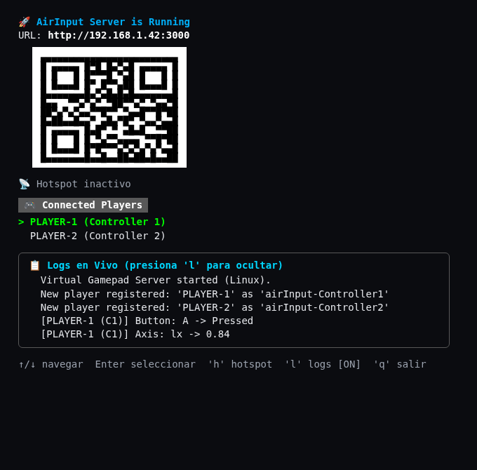

---

## Características Principales

- **Sin Instalación en el Móvil**: Funciona íntegramente desde el navegador web del teléfono a través de tu red local o mediante punto de acceso directo.
- **8 Diseños de Mando (Clásicos y Touch-First)**: Cambia en tiempo real entre mandos clásicos, controles modernos de doble stick (simétrico, asimétrico y doble stick dinámico) y controles *Touch-First* diseñados específicamente para la ergonomía de pantallas táctiles según el género del juego.
- **Zonas de Stick con Posición Dinámica**: Todas las carcasas con sticks analógicos cuentan con áreas táctiles dinámicas donde el centro del stick aparece automáticamente en el punto exacto del primer toque del pulgar (activable o desactivable en cualquier momento desde el menú del mando), incluyendo además el diseño **Doble Stick Dinámico (`twin-stick`)** con paneles táctiles extendidos a izquierda y derecha.
- **Modo Hotspot Wi-Fi Sin Internet**: Crea una red Wi-Fi propia (`AirInput-Net`) desde cero directamente desde el PC cuando no hay router ni conexión a internet disponible. *(Probado en Linux con NetworkManager; soporte en Windows incluido como experimental/no testeado).*
- **Intercambio de Mandos en Caliente (Hot-Swap)**: Reasigna qué teléfono controla al Jugador 1, Jugador 2, etc. directamente desde la interfaz de terminal (TUI) sin reiniciar el juego ni desconectar a los jugadores.

---

## Galería de Interfaz y Controles

### Pantalla de Conexión y Menú de Calibración

Antes de conectar, cada jugador elige su identificador y el diseño inicial del mando. Durante la partida, la píldora superior muestra la latencia en vivo (`ms`) y permite abrir el menú del mando para cambiar de carcasa, invertir el giro de pantalla o el eje Y, probar la vibración y calibrar la zona muerta del stick.

| Pantalla de Conexión | Menú de Calibración en Partida |
| :---: | :---: |
| 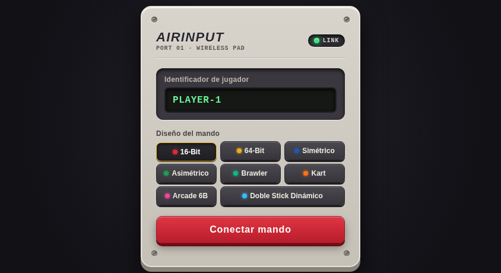 | 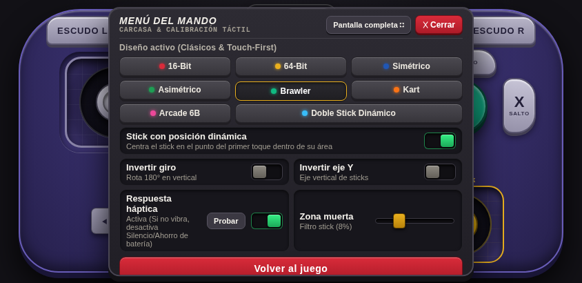 |

---

### Controles Clásicos y Estándar

| Diseño | Vista Previa |
| :--- | :---: |
| **16-Bit** | 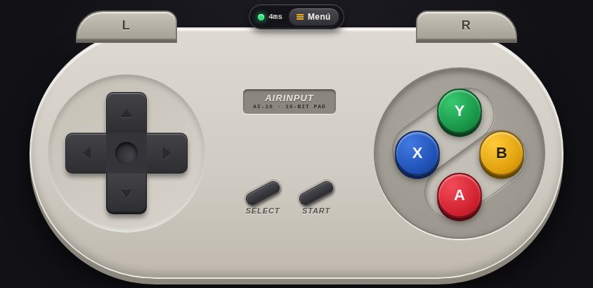 |
| **64-Bit** | 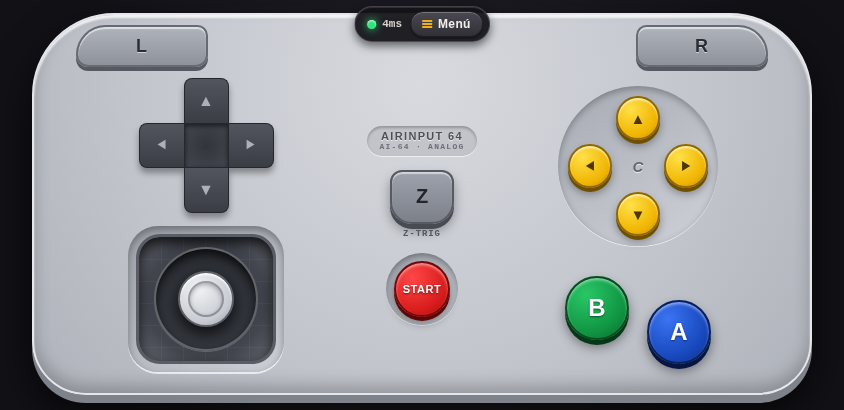 |
| **Simétrico** | 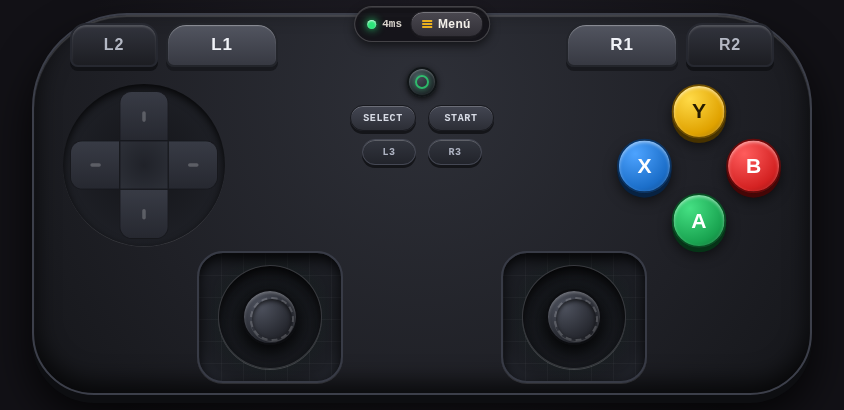 |
| **Asimétrico** | 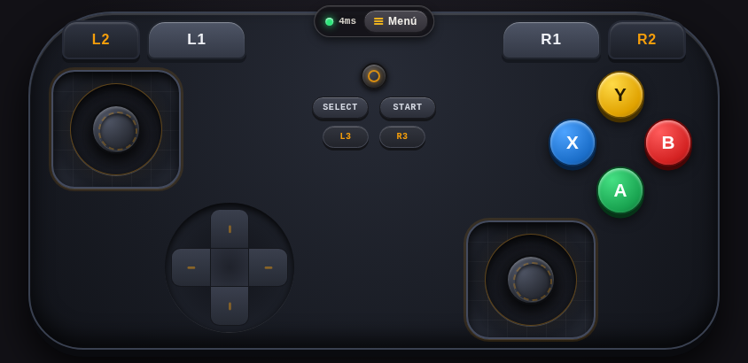 |

---

### Controles Touch-First Adaptados por Género

Diseñados desde cero para pantallas táctiles móviles evitando posturas incómodas de varios dedos:

| Diseño | Vista Previa |
| :--- | :---: |
| **Brawler (`brawler`)** | 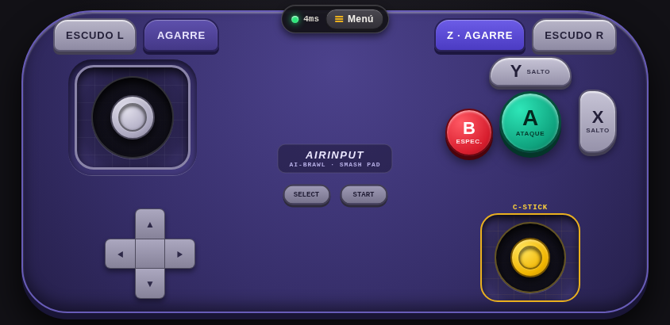 |
| **Kart / Racing (`kart`)** | 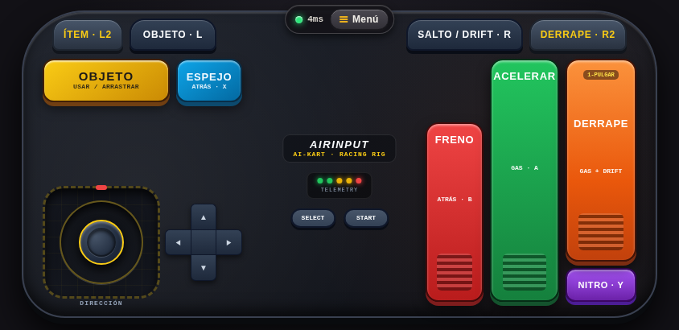 |
| **Arcade 6-Botones (`arcade`)** | 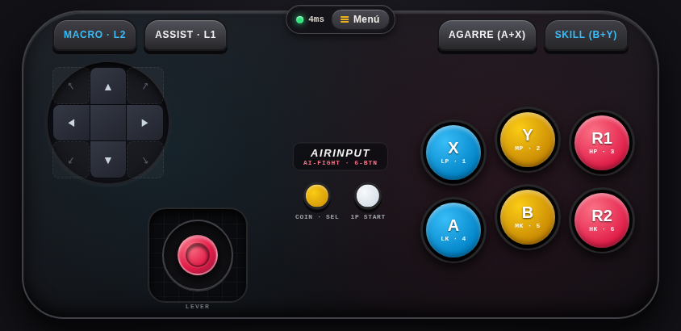 |
| **Doble Stick Dinámico (`twin-stick`)** | 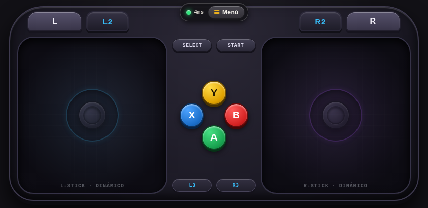 |

---

## Controles de la Terminal (TUI)

Mientras `airInput` está en ejecución, puedes gestionar la red y los mandos directamente desde la terminal:

| Tecla | Acción |
| :--- | :--- |
| `Arriba` / `Abajo` (o `k` / `j`) | Navegar por la lista de jugadores conectados. |
| `Enter` / `Espacio` | Seleccionar un jugador y luego presionar `Enter` sobre otro para **intercambiar en caliente (hot-swap)** sus números de mando virtual. |
| `Esc` | Cancelar la selección de intercambio o el aviso de confirmación del hotspot. |
| `h` | Activar o desactivar el **Hotspot Wi-Fi sin internet** (`AirInput-Net`). Regenera el código QR con la IP del punto de acceso (`10.42.0.1`) y abre el puerto `3000` en el firewall. |
| `l` | Mostrar u ocultar el panel de **Logs en Vivo** en la terminal. |
| `q` / `Ctrl+C` | Apagar el hotspot (si estaba activo), eliminar los mandos virtuales y cerrar el programa limpiamente. |

También puedes pasar opciones por línea de comandos al iniciar AirInput:

```bash
sudo ./airInput -l            # Iniciar con el panel de logs en vivo activado
sudo ./airInput -dev          # Servir ./public desde disco en vez del binario embebido (para desarrollo UI)
sudo ./airInput -port 3000    # Puerto HTTP/WebSocket personalizado (por defecto: 3000)
```

---

## Inicio Rápido

### Requisitos Previos

- **Go** (1.20 o superior) para compilar desde el código fuente.
- **Linux**: Módulo `uinput` del kernel (incluido de serie en las distribuciones actuales; puedes cargarlo con `sudo modprobe uinput` si fuera necesario).
- **Windows *(Experimental / No testeado)***: Driver [ViGEmBus](https://github.com/nefarius/ViGEmBus/releases) instalado y `ViGEmClient.dll` ubicado en la misma carpeta que `airInput.exe` (o en el `PATH` del sistema).

### 1. Clonar el repositorio y compilar el binario único

**Linux:**
```bash
git clone https://github.com/DiegoCChumbi/airInput.git
cd airInput
go build -o airInput .
```

**Windows:**
```powershell
git clone https://github.com/DiegoCChumbi/airInput.git
cd airInput
go build -o airInput.exe .
```

### 2. Ejecutar AirInput

**Linux:**
```bash
sudo ./airInput
```
*(Se requiere `sudo` en Linux para crear dispositivos en `/dev/uinput` y gestionar el punto de acceso Wi-Fi con NetworkManager).*

**Windows *(Experimental / No testeado)*:**
```powershell
airInput.exe
```

---

## Cómo Funciona

```text
┌─────────────────┐       WebSocket (/ws :3000)       ┌────────────────────────────────────┐
│ Navegador Móvil │ ◄───────────────────────────────► │      Binario Único AirInput (Go)   │
│ (Cliente Táctil)│     Botones, Ejes y Ping RTT      │                                    │
└─────────────────┘                                   │  ┌──────────────┐  ┌────────────┐  │
                                                      │  │  WebServer   │  │ Bubble Tea │  │
                                                      │  │ (go:embed +  │◄─┤  Host TUI  │  │
                                                      │  │  WebSocket)  │  │ y Hotspot  │  │
                                                      │  └──────┬───────┘  └─────┬──────┘  │
                                                      │         │   En Memoria   │         │
                                                      │         ▼    Directo     ▼         │
                                                      │  ┌──────────────────────────────┐  │
                                                      │  │        GamepadManager        │  │
                                                      │  │  (Linux uinput / Win ViGEm)  │  │
                                                      │  └──────────────┬───────────────┘  │
                                                      └─────────────────┼──────────────────┘
                                                                        │
                                                               ┌────────▼─────────┐
                                                               │ Mandos Virtuales │
                                                               │ (Controller 1..N)│
                                                               └──────────────────┘
```

1. **Host TUI y Hotspot (`airInput.go`, `hotspot.go`)**: Dibuja la interfaz interactiva en terminal (Bubble Tea), genera el código QR en terminal directamente en Go, gestiona la creación del Hotspot Wi-Fi offline y las reglas del firewall, y ejecuta el intercambio de mandos (*hot-swap*).
2. **Servidor HTTP Embebido y WebSocket (`web_server.go`)**: Sirve el cliente web móvil directamente desde la memoria del ejecutable (`//go:embed public`, o desde disco con `-dev`), gestiona el registro de jugadores, mide el ping RTT y encamina los eventos de botones y ejes directamente en memoria sin saltos por red local ni subprocesos.
3. **Driver Nativo de Mandos Virtuales (`gamepad.go`, `gamepad_linux.go`, `gamepad_windows.go`)**: Crea un mando virtual independiente por cada jugador registrado mediante llamadas `ioctl` nativas sobre `/dev/uinput` en Linux o a través de `ViGEmClient.dll` en Windows.

---

## Estructura del Proyecto

```text
airInput/
├── airInput.go              # TUI en Go (Bubble Tea) y punto de entrada principal
├── web_server.go            # Servidor HTTP embebido (//go:embed public), WebSocket y generador QR
├── gamepad.go               # GamepadManager multiplataforma e interfaz VirtualDevice
├── gamepad_linux.go         # Driver nativo Linux /dev/uinput mediante syscall/ioctl
├── gamepad_windows.go       # Driver Windows ViGEmBus mediante ViGEmClient.dll (experimental)
├── hotspot.go               # Gestión de Hotspot Wi-Fi offline y firewall (Linux/Windows)
├── docs/
│   └── screenshots/         # Capturas de pantalla de la TUI y de los 8 mandos
└── public/                  # Cliente web móvil (embebido en el binario Go al compilar)
    ├── index.html           # Pantalla de conexión, barra HUD y menú de calibración
    ├── global.css           # Sistema de diseño de hardware y rotación responsiva
    ├── script.js            # Escáner multitáctil, joysticks con rotación, WebSocket y motor háptico
    └── skins/               # Diseños modulares de controles
        ├── snes/            # Mando clásico de 16-Bit
        ├── n64/             # Mando analógico de 64-Bit
        ├── xbox/            # Mando moderno simétrico
        ├── asymmetric/      # Mando moderno asimétrico
        ├── brawler/         # Mando Touch-First para plataformas de pelea
        ├── kart/            # Mando Touch-First con volante y pedalera de carreras
        ├── arcade/          # Tablero Arcade Fightpad de 6 botones
        └── twin-stick/      # Mando de doble stick con posición dinámica
```

---

## Solución de Problemas

### Problemas de Conexión y Hotspot Offline
- **El teléfono no carga la página al conectarse a `AirInput-Net`**: Como el punto de acceso offline no tiene salida a internet, algunos teléfonos redirigen el tráfico automáticamente por los datos móviles (`4G`/`5G`). Apaga los **Datos Móviles** en el celular o acepta el aviso del sistema **"Mantener conexión Wi-Fi"** al conectarte a `AirInput-Net`.
- **Firewall bloqueando el puerto 3000**: AirInput abre automáticamente el puerto TCP `3000` mediante `ufw`, `firewall-cmd` o `iptables`. Si utilizas otro firewall personalizado, permite conexiones entrantes TCP en el puerto `3000`.

### La Respuesta Háptica No Vibra
- **Android**: Asegúrate de desactivar el **Ahorro de batería**, **No Molestar** y el **Modo Silencio**, y verifica que la **Vibración táctil / Vibración de notificaciones** esté activa en los ajustes del sistema (Android bloquea `navigator.vibrate` en todos los navegadores cuando el ahorro de batería o el modo silencio están activos).
- **Botón de Prueba**: Abre el **Menú** dentro del mando y toca **Probar** junto a *Respuesta háptica* para verificar la vibración del dispositivo.

---

## Estado de Tareas (Roadmap)

- [x] Permitir que cada jugador ingrese un identificador para su mando
- [x] Vincular teléfonos con números de mando e intercambiarlos en caliente desde la terminal
- [x] Crear una red Wi-Fi propia (Hotspot) para funcionar sin router ni internet previo
- [x] Añadir diseños de mandos *Touch-First* adaptados por género (`Brawler`, `Kart`, `Arcade 6-Botones`, `Asimétrico`, `Doble Stick Dinámico`)
- [x] Soportar posicionamiento dinámico en todas las áreas de sticks analógicos

---

## Licencia

Este proyecto está licenciado bajo la Licencia MIT.
